# SportsAgenticUI

The chat UI for [sportsagentic.dev](https://sportsagentic.dev), a college football AI assistant. It's a static React app in [`web/`](web/) that talks to the [SportsAgenticAgent](https://github.com/tmonteith/SportsAgenticAgent) orchestrator over server-sent events. The API it depends on is described in [`docs/backend-contract.md`](docs/backend-contract.md).

---

## Architecture



SportsAgenticUI is a modern React SPA paired with Kubernetes ingress routing:
- **Client Application** (`web/src`): Built with React 18, TypeScript, Tailwind CSS, and `@assistant-ui/react`. Features an interactive conversation thread, message composer, and live tool execution cards (`get_cfb_scores`, etc.).
- **Streaming SSE Engine** (`web/src/lib/stream/`): A lightweight custom SSE parser and stream adapter that connects to `POST /api/chat/stream`, translating live `tool.start`, `tool.end`, and `message.delta` events directly into thread state.
- **Container Packaging** (`web/Dockerfile` & `web/nginx.conf`): Built as an unprivileged Nginx container serving compiled SPA assets on port 8080 with gzip compression, HTML5 pushState fallback (`/index.html`), and a `/healthz` liveness probe.
- **Ingress Layer** (`web/deploy/sportsagentic-web`): Configures Ingress-Nginx on `sportsagentic.dev` with two ingress objects:
  - `sportsagentic-web`: Routes root `/` to the Nginx SPA frontend.
  - `sportsagentic-web-api`: Routes `/api/(.*)` to `sportsagentic-agent:8000` with path regex rewriting (`/$2`), response buffering disabled (`proxy-buffering: off`), and a 300-second read timeout for streaming SSE.

---

## Run it locally

You need Node 26 and pnpm 12. The orchestrator must be on a version that includes `POST /chat/stream`.

```bash
# In SportsAgenticAgent
uvicorn app.main:app --port 8000 --reload
```

```bash
# In web/
pnpm install
pnpm dev
```

Open http://localhost:5173. The dev server proxies `/api` to `http://localhost:8000`. Set `API_PROXY_TARGET` to point it somewhere else.

To work on the UI without the orchestrator, run the mock server and point the proxy at it:

```bash
node tests/mock-server.mjs
```

```bash
API_PROXY_TARGET=http://localhost:8899 pnpm dev
```

## Test it

```bash
pnpm lint
pnpm typecheck
pnpm test
pnpm test:e2e
```

The end-to-end tests run against `vite preview` and the mock server, so they don't need API keys. Run `pnpm exec playwright install chromium` once first.

## Deploy it

CI builds a multi-arch image on every push to `main` that touches `web/`, and tags it with the 7-character git SHA. It needs these repository secrets: `OCIR_REGISTRY`, `OCIR_NAMESPACE`, `OCIR_USERNAME`, and `OCIR_AUTH_TOKEN`.

Releases are manual, like the other SportsAgentic charts:

```bash
helm upgrade --install sportsagentic-web web/deploy/sportsagentic-web \
  --namespace sportsagentic \
  --set image.repository=ord.ocir.io/<namespace>/sportsagentic/web \
  --set-string image.tag=<git-sha>
```

The chart deploys the UI and creates the `sportsagentic.dev` ingress. `/api` goes to `sportsagentic-agent` with the prefix stripped and response buffering off, and everything else goes to the UI.
